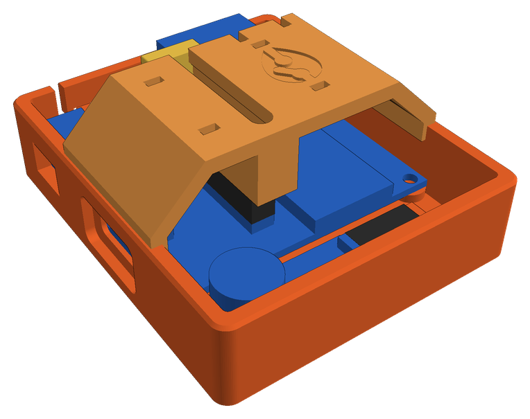
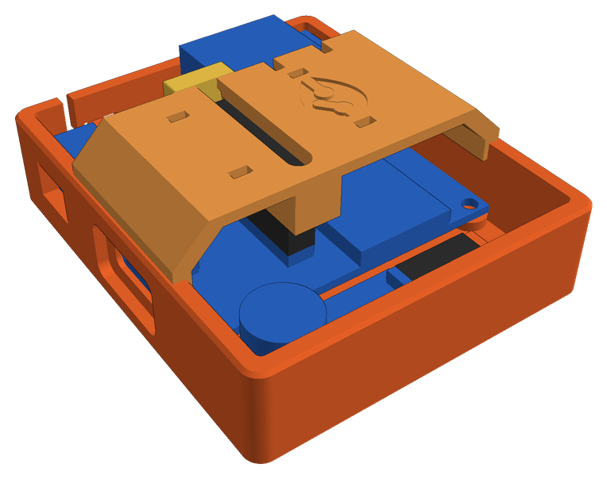
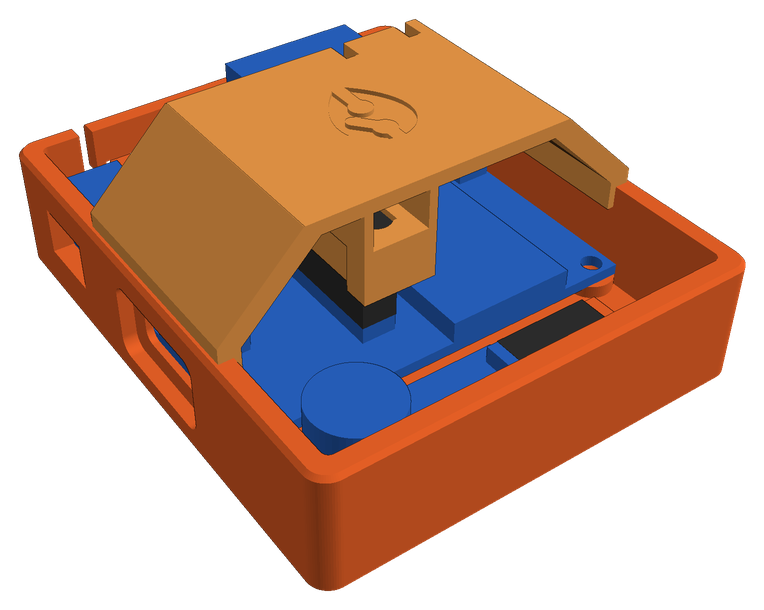
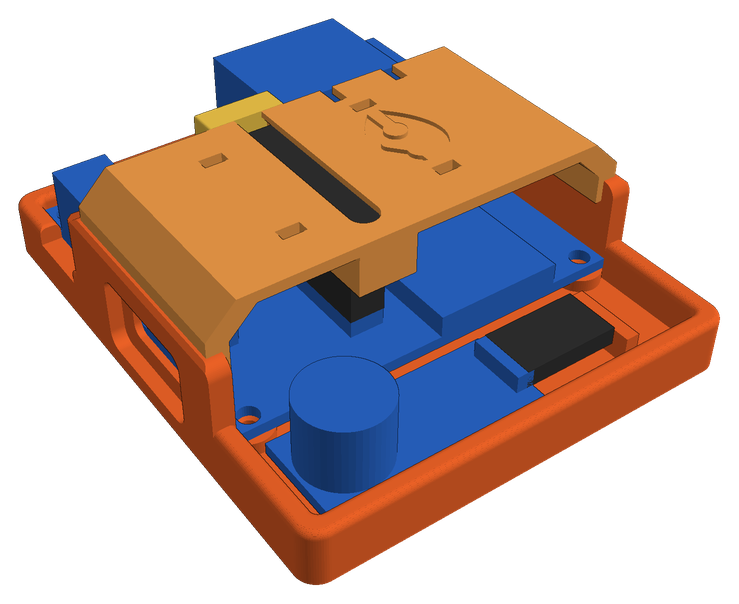
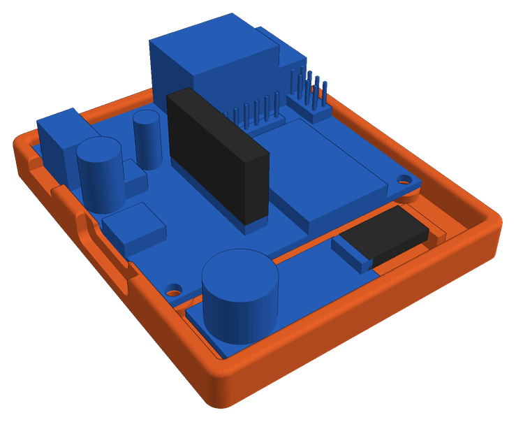

# Open Brew by Weight enclosure

> **Work in progress.** These designs are still being tested and may change at any time.

3D-printable enclosures for the [Open Brew by Weight](https://github.com/Cheerpipe/Open-Brew-by-Weight)
controller: an ESP32-S3 Relay X1 board with the buzzer module. Every version shares the same board
mounts and openings; they differ in how much plastic they use and in how the 2×10 connector is held down.

The case is built from three kinds of parts:

- **Case:** the tray the board and the buzzer module screw into.
- **Bridge:** a cover that snaps into the case over the 2×10 dupont connector so it can't work loose.
- **Clip:** a small piece that holds the two halves of the bridge together at its open end.

## Versions

Each version is a complete kit in its own folder in [`print/`](print). Pick one and print everything in it.

| | Version | Total height | Parts |
|---|---|---|---|
| 1 | [Full case, original bridge](#1-full-case-original-bridge) | 31.0 mm | Case, bridge, clip |
| 2 | [Full case, low profile bridge](#2-full-case-low-profile-bridge) | 26.6 mm | Case, bridge (open or closed), clip |
| 3 | [Full case, bridge with tunnel](#3-full-case-bridge-with-tunnel) | 32.05 mm | Case, bridge |
| 4 | [Minimal case with bridge](#4-minimal-case-with-bridge) | 24.55 mm | Minimal case, minimal bridge, clip |
| 5 | [Open minimal case](#5-open-minimal-case) | 8.7 mm | Minimal case |

The board in the pictures is a rough model, only there to show the fit.

### 1. Full case, original bridge

Folder: [`print/1-original`](print/1-original)



The full-height case (18.1 mm walls) with a cable labyrinth on the side, plus the original bridge. The bridge
sits highest of the open bridges and leaves the most room above the connector, so the wires have a longer
straight run before they bend. Use it if your wires are stiff or your dupont housing is tall.

### 2. Full case, low profile bridge

Folder: [`print/2-lowprofile`](print/2-lowprofile)



The same full case with a bridge whose plate rests right on the lips over the connector housing, 4.4 mm lower
than the original. This is the default. The folder also has a **closed** bridge, closed at both ends, that
needs no clip; the connector must be threaded through it before you plug it in.

### 3. Full case, bridge with tunnel

Folder: [`print/3-lowprofile-tunnel`](print/3-lowprofile-tunnel)



The full case with a bridge that has a closed roof instead of a slit. The wires rise from the connector, fold into
a duct under the roof and leave through either end, so nothing crosses the top. The roof joins both halves, so
it needs no clip and no cable ties. It is the tallest version.

### 4. Minimal case with bridge

Folder: [`print/4-minimal-case-and-bridge`](print/4-minimal-case-and-bridge)



A low tray with a rounded rim 2 mm above the board, keeping full-height walls only where the bridge snaps in.
It comes with the minimal bridge, a thin 1.6 mm plate flush with the lips that hold the housing: the lowest
bridge and the one with the least plastic. Wires leave over the rim, and they start to bend just above the
housing, so fold them gently. Any bridge from the other kits also fits this case.

### 5. Open minimal case

Folder: [`print/5-minimal-case-only`](print/5-minimal-case-only)



Only the low tray: the full 3.2 mm floor, the board and module rests, and the rounded rim. It protects and
insulates the bottom of the board and uses about 25 % less plastic than the full case. There is no bridge, so
nothing holds the 2×10 connector down.

## Printing

Settings for PETG. The files are already oriented for the bed, so don't rotate them.

- **Supports:** off for all parts.
- **Layer height:** 0.2 mm.
- **Walls:** 3–4.
- **Infill:** 30–40 % for the case and the bridge, 100 % for the clip.
- **Adhesion:** a 3–5 mm brim on the bridge.

Each kit folder has the parts in STL, 3MF and OBJ.

## What you'll need

- 4 M2.5 × 4 mm screws (or similar): they thread straight into the printed boss through a 2.4 mm hole that goes all the way through the floor. No inserts needed.
- One 2×10 dupont housing, with pin 1 marked on both the housing and the board.
- Cable ties about 2.5 mm wide (versions 1, 2 and 4).

## Assembly

1. Screw down the board and the buzzer module.
2. Plug in the buzzer connector, which sits against the stop, and the 2×10 connector.
3. Slide the bridge over the wires and press it down until it clicks into the case. For the tunnel bridge,
   fold the wires towards the end you want and lower the bridge over them.
4. Slide the clip onto the two horns from the open end until it stops. It is a solid block with a socket for each
   horn, so it holds the halves together and apart. A ridge in each socket rides in the horn's notch for extra grip.
5. Tie the wires leaving the case to the bridge slots with a cable tie.

To remove the clip, pull it straight back off the horns. If it still works loose, put a drop of cyanoacrylate glue on the horns before sliding it on.

## Changing the design

The models are written in Python, so every dimension is a named value you can change and rebuild.

| Folder | Contents |
|---|---|
| [`src/`](src) | `case.py` holds the case, the bridges and the clips; `board.py` is a rough model of the board, used only to check fit. |
| [`viewer/`](viewer) | `make_viewer.py` builds a single-file 3D viewer of everything assembled; `render_images.py` renders the pictures in `images/`. |
| [`print/`](print) | The ready-to-print files, one folder per kit. |

You need Python 3 (tested with 3.14). Run these from the repository folder:

```bash
python3 -m venv venv
```

```bash
venv/bin/pip install -r requirements.txt
```

```bash
venv/bin/python src/case.py
```

```bash
venv/bin/python viewer/make_viewer.py && open viewer/viewer.html
```

`src/case.py` writes the files in `print/` and lists each part with its size. The viewer is a single HTML file
that loads its 3D library from the internet; on Linux use `xdg-open` instead of `open`. Drag to rotate, scroll to
zoom, and use the checkboxes to show or hide parts. `venv/bin/python viewer/render_images.py` redraws the pictures.

### If something doesn't fit

Printers differ. Change one value near the top of `src/case.py` and rebuild:

| Value | Adjusts |
|---|---|
| `SELFTAP_HOLE` | Screw hole diameter, 2.4 mm by default (for M2.5). See [Screw hole size](#screw-hole-size). |
| `HOUSING_H` | Height of your 2×10 dupont housing. |
| `VARIANTS` | Gap above the lips and plate thickness of each bridge. Raise the gap to give the wires a longer straight run before they bend, at the cost of that much height. |
| `DUCT_W`, `DUCT_H` | Width and height of the duct in the tunnel bridge. |
| `P4_WIRES`, `P4_PLUG`, `P4_GAP` | Plug on the 1×6 P4 header. `P4_WIRES` lists the pins that have wires (default 1 and 5, counting from 1 at the pin nearest the case's right wall); the bridge covers the rest of the plug and opens a slot only over those. If your pin numbering runs the other way, use `(2, 6)`. `P4_GAP` is the gap above the plug (0.2 mm): raise it if the bridge will not snap in. `P4_PLUG` is the plug footprint. |
| `SNAP_BUMP`, `SNAP_CLEAR` | Bridge-to-case snap: first number of each point is the hook depth (1.2 mm). Raise it to hold harder, lower it if the bridge is too hard to press in. `SNAP_CLEAR` is the groove clearance: lower it if the bridge rattles. |
| `CLIP_CLEAR` | Clip fit, 0.05 mm by default: raise it (0.1, 0.15) if the clip will not slide on, set it to 0 if it is loose. `CLIP_BACK`, `CLIP_WALL` and `CLIP_BAR` set how thick the clip is. |
| `SPK_STOP_FACE_X` | Position of the buzzer connector stop. |

#### Screw hole size

The four screw holes go all the way through the boss and the floor, and the screw cuts its own thread in the
plastic. To change the width, edit this line near the top of `src/case.py`:

```python
INSERT_HOLE, SELFTAP_HOLE = 3.4, 2.4
```

Change the second number, `SELFTAP_HOLE` (in mm), then run `venv/bin/python src/case.py` to rebuild every case in `print/`.
A good starting point is the screw's thread diameter minus about 0.3 mm (2.4 here for M2.5, 1.7 for M2, 2.7 for M3).
Make it smaller if the screws are loose, larger if they won't go in. If you prefer heat-set inserts, set
`SCREW_MODE = "insert"` on the line above it: the holes then use `INSERT_HOLE` and stop 3.2 mm down instead of
going through.

## License

[AGPL-3.0-or-later](LICENSE), the same as [Open Brew by Weight](https://github.com/Cheerpipe/Open-Brew-by-Weight).
This covers the Python sources, the printable files and the pictures. The Open Brew by Weight logo engraved on the
bridges is licensed under [CC BY 4.0](LICENSES/CC-BY-4.0.txt).
